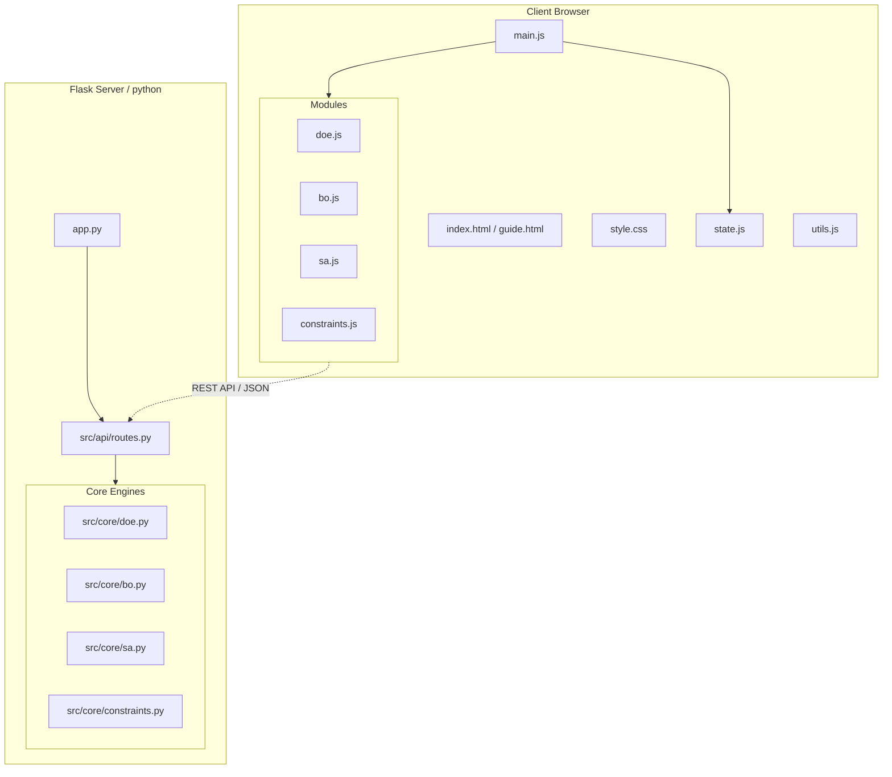

# EDOS Architecture & File Relationships

This document describes the structure of the **Experimental Design and Optimization System (EDOS)** application, the responsibilities of each file, and how they work together to create the full application.

---

## Architecture Overview

EDOS is built as a **Single Page Application (SPA)** with a **Flask Python backend** and a **Vanilla HTML5/CSS3/JavaScript frontend**. The backend serves both as the web server and the heavy-computation engine (using PyTorch, BoTorch, GPyTorch, Scikit-Learn, and PyDOE).

The repository is organized as follows:

---

## File-by-File Breakdown

### 1. Root Bootstrapping & Configuration

*   **`app.py`**:
    *   **Role**: Entry point for starting the application.
    *   **Details**: Configures the Flask application, sets up static and template resource directories, and registers the API blueprints. It is built to support both developer mode (running on port `7860` or via `$PORT` environment variables on spaces/deployments) and standalone frozen executables created by PyInstaller (by resolving the temporary directory `sys._MEIPASS` and auto-opening the default browser on port `5000`).
*   **`requirements.txt`**:
    *   Lists all necessary Python dependencies (Flask, torch, botorch, gpytorch, scikit-learn, PyDOE, pandas, numpy).
*   **`Dockerfile`**:
    *   Used to containerize the app for cloud deployments, such as Hugging Face Spaces (runs on port `7860`).

---

### 2. Frontend Layer (Single Page Application)

All templates and static assets are served from the `templates/` and `static/` directories:

*   **Templates**:
    *   **`templates/index.html`**: The main user interface. It defines the layout, control panels, file upload zones, tables for inputting/configuring experimental data, and placeholders for interactive Plotly charts.
    *   **`templates/guide.html`**: A standalone user guide explaining experimental design, optimization strategies, and simulated annealing.
*   **Styling**:
    *   **`static/style.css`**: Implements custom modern design elements, responsive layouts, color themes, and visual component decorations (e.g., cards, tables, status indicators, and modal popups).
*   **Application Scripts (`static/js/`)**:
    *   **`static/js/main.js`**: Main entry point for the frontend application logic. It initializes module switches, manages file upload listeners, initializes Plotly containers, and hooks buttons up to their respective handlers.
    *   **`static/js/state.js`**: Manages global frontend state variables (e.g. `currentData`, `currentColumns`, `columnRoles`, configurations for the active module, suggestions cache, and request AbortControllers) attached to the `window` object to allow seamless cross-module interaction.
    *   **`static/js/utils.js`**: Contains helper functions for event-listener binding, spreadsheet CSV exports, Pareto-front index detection, and configuration rebalancing.
*   **Feature Modules (`static/js/modules/`)**:
    *   **`static/js/modules/doe.js`**: Controls the Design of Experiments UI. Captures input configurations (factors/levels/types), dispatches requests to `/doe`, and displays the generated design tables and design properties.
    *   **`static/js/modules/bo.js`**: Manages the Bayesian Optimization UI. Captures parameter bounds, optimization objectives, custom hyperparameters (acquisition function, noise, strategy), posts to `/optimize` or `/estimate_bo`, and visualizes trends and Pareto fronts using Plotly.
    *   **`static/js/modules/sa.js`**: Handles the Statistical Analysis UI. Allows selection of target features/objectives, executes analysis via `/sa`, and builds interactive Plotly charts showing correlation matrices, feature importances, and SHAP-like impact analysis.
    *   **`static/js/modules/constraints.js`**: Manages frontend interaction for constraints definition, including handling formulas, custom rules, and UI updates.

---

## 3. Backend API Layer

*   **`src/api/routes.py`**:
    *   **Role**: Acts as the communication bridge between the browser frontend and the mathematical engines.
    *   **Details**: Exposes REST endpoints that accept JSON parameters or multipart form data (CSV uploads). Before returning responses, it runs `clean_json_data` to sanitize special float values (like `NaN` or `Infinity`) which are invalid in JSON.
    *   **Key Endpoints**:
        *   `GET /`: Serves `index.html`.
        *   `GET /guide`: Serves `guide.html`.
        *   `POST /upload`: Standardizes upload of custom CSV datasets.
        *   `POST /doe`: Calls `generate_doe(...)` to produce new experimental designs.
        *   `POST /optimize`: Calls `run_bo_optimization(...)` to compute recommendations using Gaussian Processes and acquisition functions.
        *   `POST /estimate_bo`: Predicts values for specified conditions using the GP models trained on current data.
        *   `POST /sa`: Performs statistical analysis and returns correlation matrices and feature importance details.
        *   `POST /shutdown`: Allows local users to shutdown the server gracefully.

---

## 4. Core Computational Layer (`src/core/`)

These modules perform the underlying mathematical operations:

*   **`src/core/doe.py`**:
    *   **Role**: Generator for Design of Experiments (DoE).
    *   **Details**: Generates classical experimental layouts (Full/Fractional Factorial, Box-Behnken, Central Composite, Definitive Screening Designs). It also computes quality metrics like Orthogonality, Resolution, and D-Efficiency.
*   **`src/core/bo.py`**:
    *   **Role**: Bayesian Optimization Engine.
    *   **Details**: Constructs Gaussian Process regression models (using GPyTorch and BoTorch) representing objectives as a function of the features. Recommends subsequent experimental points by optimizing acquisition functions (e.g. Expected Improvement, Upper Confidence Bound, qExpectedHypervolumeImprovement) while handling mixed continuous/discrete search spaces and user constraints.
*   **`src/core/sa.py`**:
    *   **Role**: Statistical Analysis Engine (Note: SA in this context refers to Statistical Analysis, not Simulated Annealing).
    *   **Details**: Trains Random Forest or Gradient Boosting regression/classification models on loaded datasets. Extracts feature importances, builds correlation matrices, and calculates custom SHAP-like model prediction impacts to let users inspect factor effects.
*   **`src/core/constraints.py`**:
    *   **Role**: Rule Validator.
    *   **Details**: Parses and validates algebraic numerical constraints (e.g., `A + B <= 10`) and disallowed categorical combinations. This is used by the DoE and BO generators to filter invalid candidates.

---

## End-to-End Execution Flow Example: Bayesian Optimization

To illustrate how these files interact, here is the lifecycle of a **Bayesian Optimization** request:

1.  **User Action**: The user uploads their past experimental data in `index.html` (routed to `routes.py /upload` via `main.js`), configures the features/objectives in the settings panel, and clicks "Generate Suggestions".
2.  **Frontend Gathering**: `static/js/modules/bo.js` reads the parameter configurations from the DOM and state object (`static/js/state.js`), bundles them into a JSON payload, and posts it to the `/optimize` endpoint.
3.  **Route Handling**: `src/api/routes.py` parses the JSON, reads the columns, formats the data into a Pandas DataFrame, detects GPU/CPU resources, and forwards the parameters to `src/core/bo.py`.
4.  **Backend Calculation**:
    *   `src/core/bo.py` fits a multi-output or single-output Gaussian Process model.
    *   It defines the search space bounds and integrates user-defined rules using `src/core/constraints.py`.
    *   It optimizes the chosen acquisition function (e.g. Expected Improvement) to find the best candidate points.
5.  **JSON Response**: `routes.py` cleans any invalid math values (e.g., converts any `NaN` values to `None`) and sends the data back to the client browser.
6.  **Rendering UI**: `static/js/modules/bo.js` receives the candidates, lists them in the suggestions table in `index.html`, and uses Plotly to redraw interactive Pareto-front and optimization trend charts.
